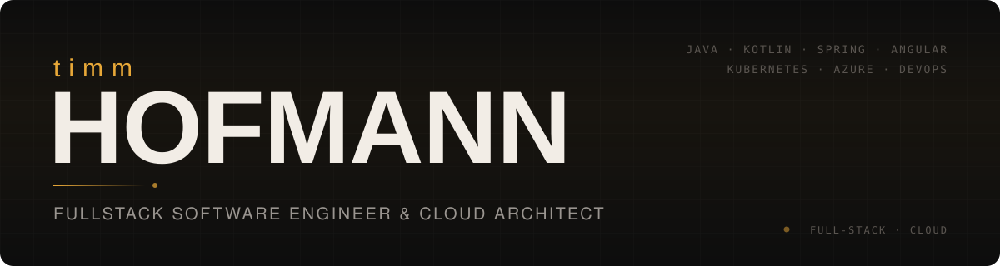

  

  
  
  
  

## 👋 About me

I'm a **Senior Software Engineer** at **compeople AG** with 8+ years of experience building
enterprise software end to end – from backend architecture and cloud infrastructure to the frontend.

- 🧩 **Focus:** Java & Kotlin backends with Spring Boot / MicroProfile, Angular frontends
- ☁️ **Cloud & DevOps:** Kubernetes, Helm and CI/CD pipelines on Azure
- 🧭 **Roles:** Technical Lead, architect and Scrum Master in public-sector and enterprise projects
- 🌱 **Currently exploring:** AI tooling, Rust and Vue

## 🛠️ Tech stack

| | |
|---|---|
| **Backend** |        |
| **Frontend** |       |
| **Cloud & DevOps** |          |
| **Data** |      |
| **Build & Tools** |      |

## 💼 Recent experience

| Period | Role | Company |
|---|---|---|
| 10/2025 – today | Senior Software Engineer | compeople AG |
| 2024 – 09/2025 | Senior Software Engineer | S&N GmbH |
| 11/2023 – 01/2025 | Senior Backend Engineer – JavaEE → Spring Boot migration | Datagroup |
| 07/2023 – 03/2024 | Technical Lead – multi-tenant cloud platform for citizen services | PublicPlan / Land NRW |
| 12/2022 – 02/2023 | Cloud Architect & DevOps – Kubernetes on Azure, Helm, GitHub Actions | COM Software GmbH |

Full project history on my personal website <a href="https://tihofman.de">tihofman.de</a> – its source lives in <a href="web/"><code>web/</code></a>.

## 📁 About this repository

This is my GitHub profile repository. Besides this README it contains my personal website,
built with **Astro** and **Tailwind CSS** (German & English), shipped as an **nginx** Docker image via
GitHub Actions. See [`web/README.md`](web/README.md) for details.
